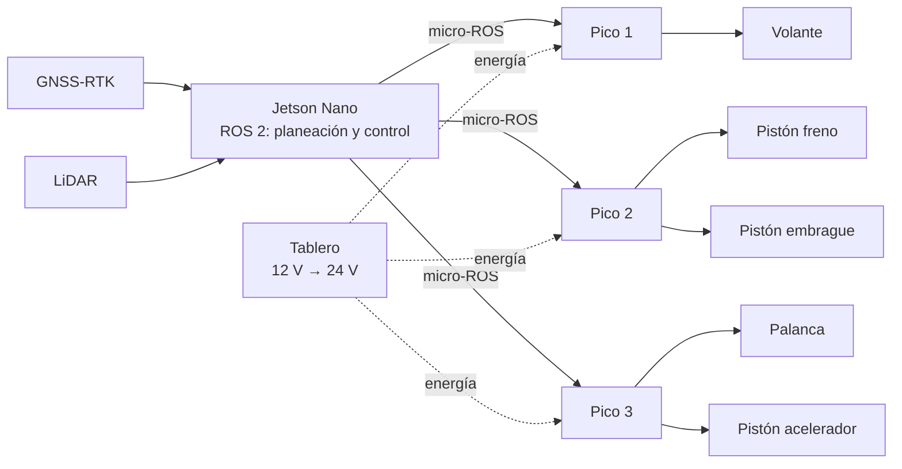

---
hide:
  - navigation
  - toc
---

Ingeniería Mecatrónica · Universidad Iberoamericana Puebla

# Agrotecnologías abiertas para México

Sistema de control autónomo no invasivo para tractor agrícola: un kit de <em>retrofit</em> que le agrega manejo autónomo a un tractor que ya existe, sin cortar, soldar ni tocar su sistema hidráulico o eléctrico.

[:material-cog: Ver el hardware](tablero.md){ .md-button .md-button--primary }
[:material-code-braces: Software ROS 2](software.md){ .md-button }
[:material-book-open-variant: Guía de uso](uso.md){ .md-button }

## El problema

2.2tractores por cada 1,000 ha en Puebla (el estándar recomendado es 5)

45 %de las unidades productivas usa tractor

85 %de quienes usan tractor lo rentan

$2–4 Mcuesta un tractor nuevo

A un tractor rentado no se le pueden hacer modificaciones permanentes. Por eso el kit debe ser **no invasivo**: todo se monta por fuera con abrazaderas y acoples rápidos, y es una alternativa accesible y replicable a comprar un tractor nuevo.

*Fuentes: Censo Agropecuario 2022 (INEGI) y Ochoa y González (2025). Proyecto del seminario de servicio social* Agrotecnologías abiertas para México.

## La propuesta

Un sistema **modular**: cada subsistema se desarrolla, prueba y cambia sin tocar los demás. Los actuadores son motores que giran el volante, empujan los pedales y mueven la palanca.

-   :material-view-dashboard-outline:{ .lg .middle } **Tablero de control**

    ---

    Gabinete con la etapa de potencia (12 → 24 V), la Jetson Nano, las tres Pico, los drivers y el GNSS-RTK.

    [:octicons-arrow-right-24: Tablero](tablero.md)

-   :material-steering:{ .lg .middle } **Volante**

    ---

    NEMA 23 con reducción 3:1, encoder AS5600 y homing sin interruptores de límite.

    [:octicons-arrow-right-24: Volante](volante.md)

-   :material-car-shift-pattern:{ .lg .middle } **Palanca y acelerador**

    ---

    Mecanismo articulado que respeta el recorrido de la transmisión original.

    [:octicons-arrow-right-24: Palanca](palanca.md)

-   :material-arrow-expand-down:{ .lg .middle } **Pistones**

    ---

    Tres husillos sobre freno, embrague y acelerador, con 3,958 N de empuje.

    [:octicons-arrow-right-24: Pistones](pistones.md)

-   :material-code-braces:{ .lg .middle } **Software (ROS 2)**

    ---

    Modelo URDF del Kubota B2401, simulación en Gazebo y nodo `goto_point.py`.

    [:octicons-arrow-right-24: Software](software.md)

-   :material-book-open-variant:{ .lg .middle } **Uso**

    ---

    Revisión previa, encendido, operación, apagado, fallas y pruebas de campo.

    [:octicons-arrow-right-24: Uso](uso.md)

### Objetivos específicos

1. Diseñar la **arquitectura** del sistema: qué partes hay, qué hace cada una y cómo se comunican.
2. Construir e integrar los actuadores de dirección, pedales y palanca.
3. **Validar** el sistema con pruebas funcionales bajo condiciones operativas simuladas.

!!! note "Alcance"
    Validar no es lo mismo que probar en campo. El alcance del proyecto llega a pruebas funcionales bajo condiciones operativas simuladas; las pruebas de campo con satélite son la siguiente etapa.

## Arquitectura: cuatro bloques

| Bloque | Papel | Qué hace |
|---|---|---|
| **GNSS-RTK** | Sentidos (posición) | Una estación base fija manda correcciones por radio al tractor; ahí, dos antenas GNSS y un módulo UM982 calculan la posición con error de centímetros. Ver [Tablero](tablero.md#posicionamiento-gnss-rtk). |
| **LiDAR** | Sentidos (entorno) | Mide distancias a obstáculos con pulsos de luz. |
| **ROS 2 en Jetson Nano** | Cerebro | La Jetson Nano corre ROS 2: planea la trayectoria y manda órdenes por tópicos. |
| **Microcontroladores** | Nervios | Tres Raspberry Pi Pico (con micro-ROS), conectadas a la Jetson, traducen cada orden en pulsos para los motores. |

| Subsistema | Controlador | Actuador | Página |
|---|---|---|---|
| Tablero de control | — | Etapa de potencia y 5 drivers | [Tablero](tablero.md) |
| Volante | Pico 1 + ATtiny412 | NEMA 23, reducción 3:1, encoder AS5600 | [Volante](volante.md) |
| Freno y embrague | Pico 2 + 2 ATtiny412 | 2 pistones (husillos), encoders AS5600 | [Pistones](pistones.md) |
| Palanca y acelerador | Pico 3 + 2 ATtiny412 | Mecanismo articulado + pistón del acelerador, encoders AS5600 | [Palanca](palanca.md) · [Pistones](pistones.md) |
| Software | Jetson Nano: ROS 2 + Gazebo | Modelo URDF y nodo `goto_point.py` | [Software](software.md) |

## Estado del proyecto

- [x] Volante
- [x] Pedales (pistones)
- [x] Palanca de velocidades
- [x] Electrónica y tablero
- [x] Control de trayectoria en ROS 2
- [ ] Pruebas de campo con el satélite (medir el error de seguimiento de ruta)

Lo que queda es la prueba, no construcción. Ver [Uso](uso.md#pruebas-de-campo).

## Equipo

- Héctor Cornejo Morales
- Ángel Iván Domínguez Cruz
- Danna Paola García Sánchez
- Pablo Eduardo Manzano López
- Héctor Ojeda Serafio
- Brian Carl Simpson y Reyes
- Apolinar Velázquez Fernández
- Emmanuel del Villar Soto

