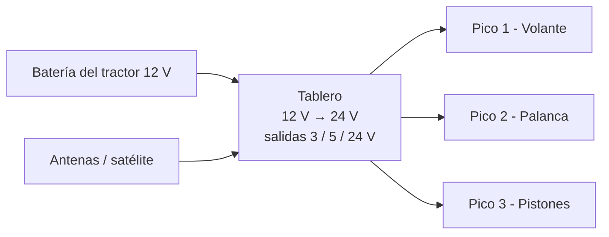

# Agrotecnologías abiertas para México

Documentación del **kit para el manejo autónomo de tractores**, un kit de automatización que permite manejar un tractor de forma autónoma, sin modificarlo permanentemente.

Proyecto del seminario de servicio social **Agrotecnologías abiertas para México**.

---

## Objetivo

<!-- Escribe aquí el objetivo general del proyecto. -->
Desarrollar un kit adaptable que automatice el volante, la palanca y los pistones (pedales/mandos) de un tractor para permitir el manejo autónomo guiado por satélite.

## ¿A quién beneficia?

<!-- Productores, comunidades, cooperativas, etc. -->
- Por completar

---

## Arquitectura general

| Subsistema | Controlador | Driver | Página |
|---|---|---|---|
| Tablero (gabinete de control) | — | — | [Tablero](tablero.md) |
| Volante | Raspberry Pi Pico #1 | Driver dedicado (más pequeño) | [Volante](volante.md) |
| Palanca | Raspberry Pi Pico #2 | Driver dedicado | [Palanca](palanca.md) |
| Pistones (3) | Raspberry Pi Pico #3 | Driver dedicado | [Pistones](pistones.md) |

---

## Estado del proyecto

- [x] Tablero
- [x] Volante
- [x] Palanca
- [x] Pistones
- [ ] Pruebas de campo con el satélite

---

## Equipo

<!-- Nombres de los integrantes -->
- Brian
- Por completar
