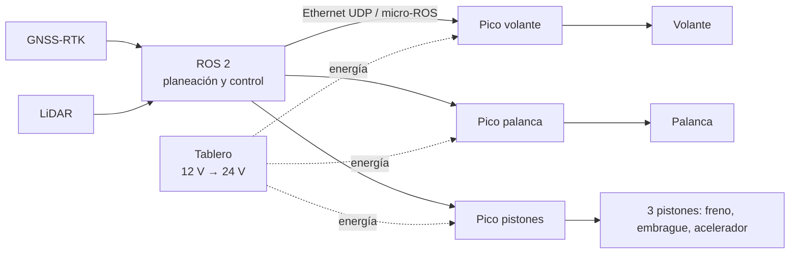

# Agrotecnologías abiertas para México

**Sistema de control autónomo no invasivo para tractor agrícola.** Es un kit de *retrofit*: le agrega manejo autónomo a un tractor que ya existe, en lugar de reemplazarlo. Todo se monta por fuera con abrazaderas y acoples rápidos. No se corta, no se suelda y no se toca el sistema hidráulico ni el eléctrico original.

Proyecto del seminario de servicio social *Agrotecnologías abiertas para México*.

---

## El problema

- **El campo poblano está poco mecanizado.** Puebla tiene 2.2 tractores por cada 1,000 hectáreas cultivadas; el estándar técnico recomendado es 5.
- **La mayoría renta.** Solo el 45 % de las unidades productivas usa tractor, y de ellas el 85 % lo renta.
- **Por eso debe ser no invasivo.** A un tractor rentado no se le pueden hacer modificaciones permanentes.
- Un tractor nuevo cuesta de 2 a 4 millones de pesos; el kit busca ser una alternativa accesible y replicable.

*Fuentes: Censo Agropecuario 2022 (INEGI) y Ochoa y González (2025).*

---

## La propuesta

Un sistema **modular**: cada subsistema (dirección, pedales, palanca, percepción) se desarrolla, prueba y cambia sin tocar los demás. Los actuadores son motores que giran el volante, empujan los pedales y mueven la palanca.

### Objetivos específicos

1. Diseñar la **arquitectura** del sistema: qué partes hay, qué hace cada una y cómo se comunican.
2. Construir e integrar los actuadores de dirección, pedales y palanca.
3. **Validar** el sistema con pruebas funcionales bajo condiciones operativas simuladas.

!!! note "Alcance"
    Validar no es lo mismo que probar en campo. El alcance del proyecto llega a pruebas funcionales bajo condiciones operativas simuladas; las pruebas de campo con satélite son la siguiente etapa.

---

## Arquitectura: cuatro bloques

| Bloque | Papel | Qué hace |
|---|---|---|
| **GNSS-RTK** | Sentidos (posición) | Posicionamiento satelital con corrección desde una estación base; error de centímetros en buenas condiciones. |
| **LiDAR** | Sentidos (entorno) | Mide distancias a obstáculos con pulsos de luz. |
| **ROS 2** | Cerebro | Planea la trayectoria y manda órdenes por tópicos. |
| **Microcontroladores** | Nervios | Tres Raspberry Pi Pico (con micro-ROS) traducen cada orden en pulsos para los motores. |

| Subsistema | Controlador | Actuador | Página |
|---|---|---|---|
| Tablero de control | — | Etapa de potencia y 5 drivers | [Tablero](tablero.md) |
| Volante | Pico #1 + ATtiny412 | NEMA 23, reducción 3:1, encoder AS5600 | [Volante](volante.md) |
| Palanca | Pico #2 | Mecanismo articulado | [Palanca](palanca.md) |
| Pistones | Pico #3 | 3 husillos sobre los pedales | [Pistones](pistones.md) |
| Software | ROS 2 + Gazebo | Modelo URDF y nodo `goto_point.py` | [Software](software.md) |

---

## Estado del proyecto

- [x] Volante
- [x] Pedales (pistones)
- [x] Palanca de velocidades
- [x] Electrónica y tablero
- [x] Control de trayectoria en ROS 2
- [ ] Pruebas de campo con el satélite (medir el error de seguimiento de ruta)

Lo que queda es la prueba, no construcción. Ver [Uso](uso.md#pruebas-de-campo).

---

## Equipo

- Héctor Cornejo Morales
- Ángel Iván Domínguez Cruz
- Danna Paola García Sánchez
- Pablo Eduardo Manzano López
- Héctor Ojeda Serafio
- Brian Carl Simpson y Reyes
- Apolinar Velázquez Fernández
- Emmanuel del Villar Soto
