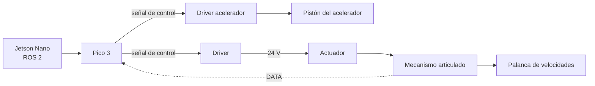

# Palanca de velocidades y acelerador

La palanca se acciona con un **mecanismo articulado** que respeta el recorrido de la transmisión original del tractor. Ya está construida e integrada al sistema.

- **Controlador:** Raspberry Pi Pico 3, que también maneja el **pistón del acelerador** (ver [Pistones](pistones.md))
- **Driver:** dedicado, el más pequeño del tablero, alimentado a 24 V desde el [tablero](tablero.md)
- **Retroalimentación:** línea DATA del mecanismo a su Pico

---

## Funcionamiento



El mecanismo es no invasivo: se monta por fuera con abrazaderas y acoples rápidos, igual que el resto del kit.

### Velocidades medidas

Las velocidades del tractor se cronometraron en un tramo de 50 m:

| Acelerador | Tiempo en 50 m | Velocidad |
|---|---|---|
| Mínimo | 150 s | 0.33 m/s (1.2 km/h) |
| Máximo | 60 s | 0.83 m/s (3 km/h) |

---

## Componentes

| Componente | Modelo | Notas |
|---|---|---|
| Microcontrolador | Raspberry Pi Pico 3 | Compartida con el pistón del acelerador |
| Driver | *Por completar* (el más pequeño del tablero) | 24 V |
| Actuador | *Por completar* | |
| Mecanismo | Articulado, impreso en 3D | |

!!! note "Por completar"
    El reporte todavía no trae los cálculos ni los resultados de la palanca: posiciones (velocidades) que acciona, fuerza requerida, recorrido, actuador y modelo del driver.

---

## Piezas CAD

Piezas de SolidWorks (`.SLDPRT`) del mecanismo de la palanca.

[:material-download: Descargar piezas de la palanca (.zip, 3.5 MB)](recursos/cad/Piezas_Palanca.zip){ .md-button .md-button--primary }

| Grupo | Archivos |
|---|---|
| Base y montaje | `BasePalanca`, `porta palanca`, `ChumaceraPalanca`, `perfil1`, `C` |
| Soportes | `soporte angulo`, `soporte metal`, `soporte metal2`, `soporte metal3`, `soporte metal4` |
| Motor y carcasa | `CarcasaHectorin`, `tapa carcasa`, `TapaMotor` |
| Transmisión | `40 a 20 ajustable`, `TuercaTM8` |
| Tornillería | `arandela M6`, `arandela M8`, `arandela M10`, `tuerca M4` |
| Pruebas de impresión | `PruebaEsquina`, `PruebaEsquina15`, `PruebaEsquina30` |

!!! note "Sin ensamble"
    El paquete trae solo piezas (22 archivos `.SLDPRT`); no incluye el ensamble `.SLDASM`.

---

## Conexiones

| Pico (GPIO) | Conecta a | Señal |
|---|---|---|
| | | |

## Código

```cpp
// Firmware de la Pico 3 (palanca y acelerador)
```

## Fotos

<!-- docs/recursos/ -->
