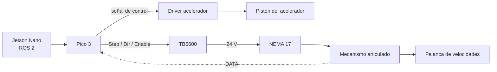

# Palanca de velocidades y acelerador

La palanca se acciona con un **mecanismo articulado** que respeta el recorrido de la transmisión original del tractor. Ya está construida e integrada al sistema.

- **Controlador:** Raspberry Pi Pico 3, que también maneja el **pistón del acelerador** (ver [Pistones](pistones.md))
- **Motor:** NEMA 17 a pasos
- **Driver:** TB6600 (hasta 4 A), el más pequeño del tablero, alimentado a 24 V desde el [tablero](tablero.md)
- **Retroalimentación:** línea DATA del mecanismo a su Pico

---

## Funcionamiento



El mecanismo es no invasivo: se monta por fuera con abrazaderas y acoples rápidos, igual que el resto del kit.

### Posiciones

La palanca se mueve entre tres posiciones:

| Posición | Uso |
|---|---|
| **Reversa** | Retroceder |
| **Neutral** | Tractor detenido o en espera; posición segura |
| **Primera** | Avanzar durante la operación autónoma |

### Fuerza requerida

Mover la palanca requiere **7 kgf**:

| Paso | Cálculo | Resultado |
|---|---|---|
| Fuerza | 7 kgf × 9.81 | **68.67 N** |

### Velocidades medidas

Las velocidades del tractor se cronometraron en un tramo de 50 m:

| Acelerador | Tiempo en 50 m | Velocidad |
|---|---|---|
| Mínimo | 150 s | 0.33 m/s (1.2 km/h) |
| Máximo | 60 s | 0.83 m/s (3 km/h) |

---

## Componentes

| Componente | Modelo | Función |
|---|---|---|
| Motor | NEMA 17 (cara de 42 mm), a pasos | Mueve el mecanismo articulado de la palanca |
| Driver | TB6600 (hasta 4 A) | Amplificador entre el micro y el motor. Señales: Step, Direction, Enable |
| Encoder | AS5600 (efecto Hall, 12 bits) | Mide la orientación de un imán pegado al eje: 0–4095 por vuelta, 0.088° por cuenta |
| Lector del encoder | ATtiny412 | Lee el AS5600 por I2C y lo envía a la Pico |
| Controlador | Raspberry Pi Pico 3 (micro-ROS) | Controla la palanca y el pistón del acelerador; se comunica con ROS 2 en la Jetson Nano |
| Mecanismo | Articulado, impreso en 3D | Respeta el recorrido de la transmisión original |


---

## Piezas CAD

Piezas de SolidWorks (`.SLDPRT`) del mecanismo de la palanca.

[:material-download: Descargar piezas de la palanca (.zip, 3.5 MB)](recursos/cad/Piezas_Palanca.zip){ .md-button .md-button--primary }

| Grupo | Archivos |
|---|---|
| Base y montaje | `BasePalanca`, `porta palanca`, `ChumaceraPalanca`, `perfil1`, `C` |
| Soportes | `soporte angulo`, `soporte metal`, `soporte metal2`, `soporte metal3`, `soporte metal4` |
| Motor y carcasa | `CarcasaHectorin`, `tapa carcasa`, `TapaMotor` |
| Transmisión | `40 a 20 ajustable`, `TuercaTM8` |
| Tornillería | `arandela M6`, `arandela M8`, `arandela M10`, `tuerca M4` |
| Pruebas de impresión | `PruebaEsquina`, `PruebaEsquina15`, `PruebaEsquina30` |

!!! note "Sin ensamble"
    El paquete trae solo piezas (22 archivos `.SLDPRT`); no incluye el ensamble `.SLDASM`.

---

## PCB

La palanca lleva su propia **PCB de actuador**, el mismo diseño que usan el volante y los pistones. Descargas y detalles en [Tablero → PCB de actuador](tablero.md#pcb-de-actuador).

---

## Conexiones

| Pico (GPIO) | Conecta a | Señal |
|---|---|---|
| | | |

## Código

```cpp
// Firmware de la Pico 3 (palanca y acelerador)
```

## Fotos

<!-- docs/recursos/ -->
