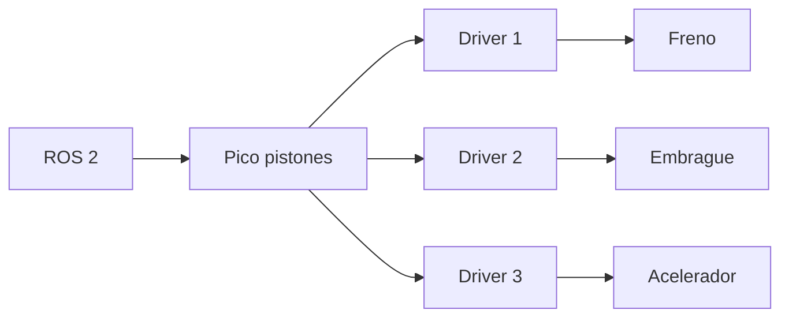

# Pistones (pedales)

Tres actuadores lineales empujan los pedales del tractor: **freno, embrague y acelerador**. Cada uno convierte el giro de un motor en empuje lineal con un **husillo** (tornillo de avance). Los controla una sola Raspberry Pi Pico, con un driver por pistón.

- **Controlador:** Raspberry Pi Pico #3
- **Drivers:** 3 × DM860H (el mismo modelo que el volante), uno por pistón, alimentados a 24 V desde el [tablero](tablero.md)

---

## Empuje por husillo

Un torque pequeño produce un empuje grande, a cambio de avanzar despacio. La fuerza se calcula con la ecuación 14.4 de Norton:

**F = 2π · τ · η ÷ p**

| Símbolo | Significado | Valor |
|---|---|---|
| τ | Torque del motor | 2.80 N·m |
| p | Paso: avance de la tuerca por vuelta | 4 mm |
| η | Eficiencia | 0.9 |
| **F** | **Empuje disponible** | **3,958.4 N (≈ 403.6 kgf)** |

Entre más fino el paso, más fuerza y menos velocidad.

---

## Factor de seguridad

| Pedal | Fuerza requerida | Factor de seguridad |
|---|---|---|
| Freno | 600 N | 6.60 |
| Embrague | 600 N | 6.60 |
| Acelerador | 120 N | 32.99 |

Factor de seguridad = fuerza disponible ÷ fuerza requerida.

!!! warning "Estimado, no medido"
    Los 600 N son una estimación basada en pruebas de operación de maquinaria agrícola, no una medición propia (a diferencia del volante). El acelerador se tomó como el 20 % de ese valor. Con un factor de 6.6, el diseño aguanta aunque la fuerza real sea varias veces mayor.

---

## Componentes

| Componente | Modelo | Notas |
|---|---|---|
| Microcontrolador | Raspberry Pi Pico | Un solo micro para los tres pistones |
| Motores (x3) | NEMA 23 a pasos | 2.80 N·m |
| Husillos (x3) | Paso 4 mm | η = 0.9 |
| Drivers (x3) | DM860H | Step / Direction / Enable, 24 V |
| Soportes | Impresos en 3D, con abrazaderas | No invasivos |



!!! note "Por confirmar"
    - El reporte no escribe p = 4 mm ni η = 0.9; son los valores que dan 3,958.4 N. Confirmarlos.
    - El mismo motor aparece con 2.80 N·m aquí y con 3 N·m en el volante. Unificar el valor.
    - Posición segura ante falla: freno aplicado y acelerador en reposo.

---

## Conexiones

| Pico (GPIO) | Conecta a | Señal |
|---|---|---|
| | | |

## Código

```cpp
// Firmware de la Pico de los pistones
```

## Fotos

<!-- docs/recursos/ -->
