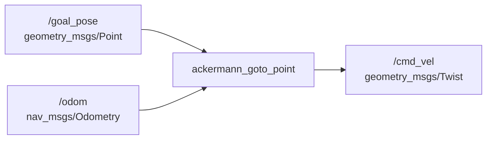

# Software (ROS 2)

El software de navegación corre en **ROS 2** sobre una **Jetson Nano**, a la que se conectan las tres Raspberry Pi Pico. Se prueba primero en simulación con **Gazebo Harmonic**. El workspace tiene dos paquetes: el modelo del tractor con su nodo de control y los mensajes propios de los actuadores.

[:material-download: Descargar workspace ROS 2 (.zip)](recursos/software/ros2_ws.zip){ .md-button .md-button--primary }

El código también está en la carpeta [`ros2_ws/`](https://github.com/BrianSimpson01/Agrotecnologias-abiertas-para-mexico-/tree/main/ros2_ws) de este repositorio.

---

## Estructura

```text
ros2_ws/
└── src/
    ├── kubota_description/
    │   ├── urdf/kubota.urdf.xacro        # modelo del Kubota B2401
    │   ├── launch/display.launch.py      # visualización en RViz
    │   ├── launch/gazebo.launch.py       # simulación en Gazebo Harmonic
    │   ├── config/view_robot.rviz
    │   └── kubota_description/goto_point.py   # nodo de control
    └── tractor_interfaces/
        └── msg/
            ├── ActuatorCommand.msg
            └── ActuatorState.msg
```

| Paquete | Qué contiene |
|---|---|
| `kubota_description` | Modelo URDF del tractor, simulación con dirección Ackermann, configuración de RViz y el nodo `goto_point.py` |
| `tractor_interfaces` | Mensajes para comandar y leer el estado de los actuadores |

---

## Modelo del tractor (URDF)

El modelo `kubota_b2401` usa la geometría real del tractor:

| Parámetro | Valor |
|---|---|
| Distancia entre ejes | 1.56 m |
| Ancho de vía trasero | 0.85 m |
| Ancho de vía delantero | 0.73 m |
| Radio de rueda trasera | 0.38 m |
| Radio de rueda delantera | 0.252 m |
| Ancho de rueda trasera / delantera | 0.22 m / 0.16 m |
| Masa del chasis | 900 kg |
| Límite de dirección (ruedas) | ±0.733 rad (≈ 42°) |

En Gazebo, el plugin `gz-sim-ackermann-steering-system` mueve el modelo: recibe `/cmd_vel` y publica `/odom` y `/tf`.

---

## Nodo `goto_point.py`

Lleva el tractor a una coordenada con **control proporcional** y se detiene a menos de 0.25 m de la meta.



| Parámetro | Valor |
|---|---|
| Frecuencia del lazo | 20 Hz |
| Ganancia lineal `kp_linear` | 0.5 |
| Ganancia angular `kp_angular` | 1.2 |
| Velocidad lineal máxima | 1.2 m/s |
| Velocidad angular máxima | 0.7 rad/s |
| Tolerancia de llegada | 0.25 m |

- **Error de rumbo:** el nodo calcula el ángulo hacia la meta y lo normaliza entre −π y π.
- **Freno en curvas:** la velocidad lineal se multiplica por `max(0.2, cos(error de rumbo))`, así el tractor desacelera en giros cerrados.
- **Saturación:** las órdenes se recortan a los límites del tractor.

!!! warning "Por unificar"
    El código limita la velocidad lineal a **1.2 m/s**, pero la velocidad máxima medida del tractor es **0.83 m/s** (3 km/h). Ajustar `max_linear_speed` al valor medido.

---

## Mensajes de los actuadores

**`ActuatorCommand.msg`**: orden a un actuador.

```text
float32 target_pos
float32 velocity
float32 acceleration
```

**`ActuatorState.msg`**: estado que reporta cada actuador.

```text
float32 current_pos
bool limit_switch_hit
bool hardware_error
```

`hardware_error` es la misma bandera que reporta el [volante](volante.md#tres-capas-de-proteccion) cuando se pierde el enlace UART o el bus I2C.

---

## Cómo usarlo

Requisitos: ROS 2 con `xacro`, `robot_state_publisher`, `joint_state_publisher_gui`, `rviz2`, Gazebo Harmonic y `ros_gz` (`ros_gz_sim`, `ros_gz_bridge`).

**Compilar**

```bash
cd ros2_ws
colcon build
source install/setup.bash
```

**Ver el modelo en RViz**

```bash
ros2 launch kubota_description display.launch.py
```

**Simular en Gazebo**

```bash
ros2 launch kubota_description gazebo.launch.py
```

**Mandar el tractor a un punto** (en otras dos terminales, con el workspace cargado)

```bash
ros2 run kubota_description goto_point.py
```

```bash
ros2 topic pub --once /goal_pose geometry_msgs/msg/Point "{x: 5.0, y: 2.0, z: 0.0}"
```

!!! note "Siguiente paso"
    Los paquetes se están migrando a la **Jetson Nano**.
