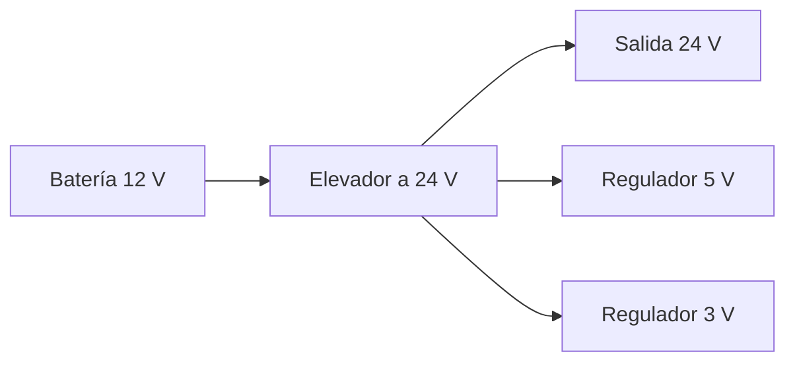

# Tablero (gabinete de control)

El **tablero** es el gabinete de control del kit (no el tablero de instrumentos del tractor). Concentra la alimentación y la comunicación de todo el sistema. Lleva las **antenas montadas encima**.

---

## Alimentación

| Etapa | Voltaje |
|---|---|
| Entrada (batería del motor del tractor) | 12 V |
| Elevación | 12 V → 24 V |
| Salidas | 3 V, 5 V y 24 V |

!!! note "Por completar"
    Modelo del elevador y reguladores, corriente máxima por salida, fusibles y protecciones.

---

## Componentes

| Componente | Modelo | Función |
|---|---|---|
| Elevador 12→24 V | | |
| Reguladores 5 V / 3 V | | |
| Antenas | | Posicionamiento / comunicación |
| Raspberry Pi Pico (x3) | RP2040 | Control de volante, palanca y pistones |

---

## Conexiones

<!-- Diagrama de cableado, conectores hacia cada subsistema -->
<!--  -->

---

## Fotos

<!-- Agrega fotos en docs/recursos/ -->
