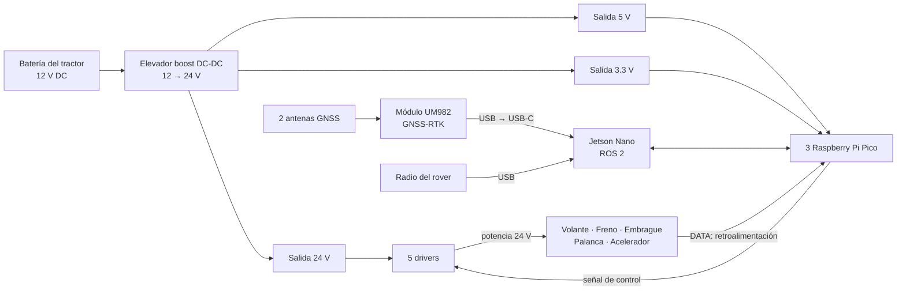
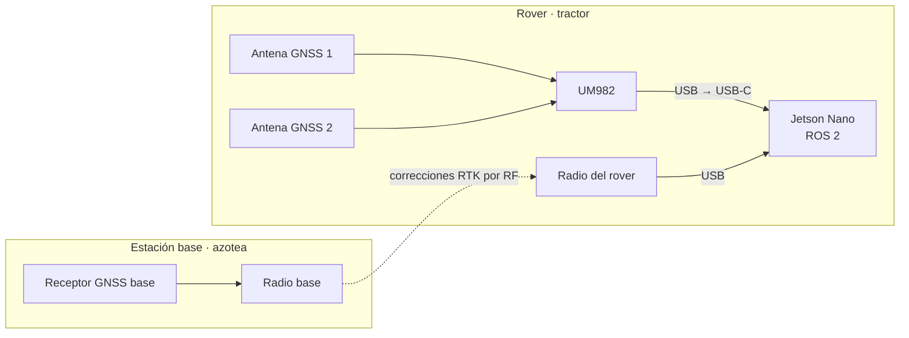
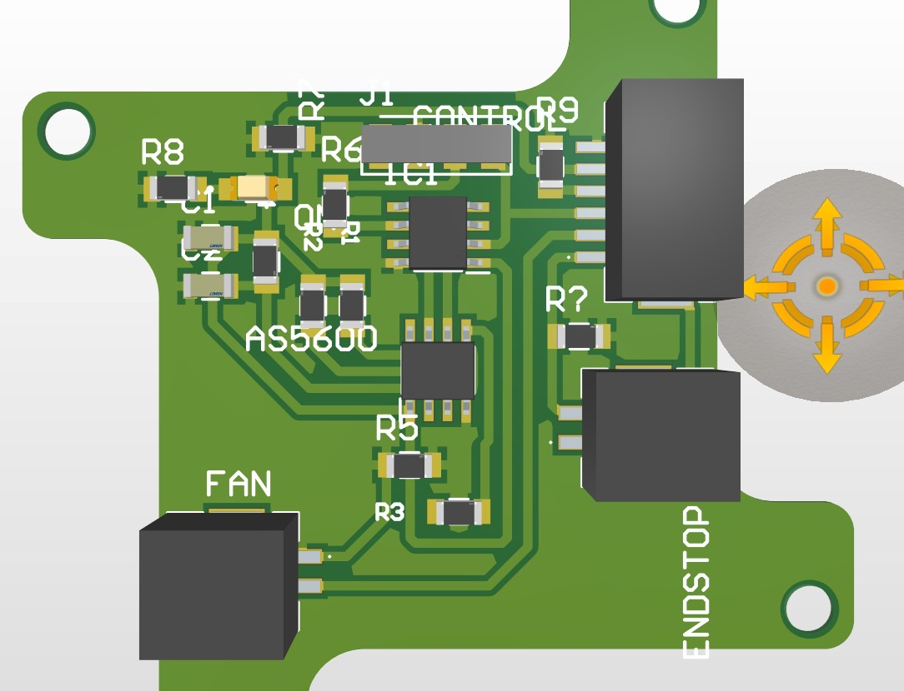

# Tablero de control

El tablero es el **gabinete que concentra la electrónica del kit** (no es el tablero de instrumentos del tractor). Se alimenta de la batería de 12 V del motor del tractor, eleva esa tensión a 24 V y entrega tres salidas reguladas (3.3 V, 5 V y 24 V) a tres Raspberry Pi Pico y a sus drivers. Las tres Pico se conectan a una **Jetson Nano**, que corre ROS 2. Encima de la caja van las **dos antenas GNSS** del módulo **UM982** (ver [Posicionamiento GNSS-RTK](#posicionamiento-gnss-rtk)).

El gabinete es una estructura de perfil de aluminio con placa de montaje perforada. Contiene la etapa de potencia, tres microcontroladores y cinco drivers de motor.

---

## Arquitectura

El tablero se divide en una **etapa de potencia** (batería → elevador → salidas reguladas) y **tres canales de control independientes**: Pico 1 para el volante, Pico 2 para los pistones de freno y embrague, y Pico 3 para la palanca y el pistón del acelerador. Cada Pico gobierna solo a sus drivers.

La separación en canales **aísla fallas**: si un canal se detiene, los otros dos conservan su control.

!!! tip "Regla fácil"
    **Cada mecanismo tiene su propio driver, y cada Pico solo maneja los suyos.** Si falla el volante, revisa solo la Pico 1 y su driver; si fallan freno o embrague, la Pico 2; si fallan palanca o acelerador, la Pico 3. El driver más pequeño es siempre el de la palanca; el volante y los pistones usan el mismo modelo (DM860H).

---

## Posicionamiento GNSS-RTK

El tractor sabe dónde está con un sistema **GNSS-RTK** de dos partes: una **estación base** fija y el **rover** (el tractor).

- **Estación base:** está fija en lo alto de un edificio. Como conoce su posición exacta, calcula las correcciones y las transmite por **radiofrecuencia**.
- **Rover (el tractor):** las dos antenas GNSS van conectadas al módulo **UM982**, que calcula la posición. Un **módulo de radio** recibe las correcciones de la base. Los dos se conectan por **USB a la Jetson Nano**: el UM982 por su USB-C y el radio por USB directo.
- **Resultado:** con las correcciones, el error de la posición baja de metros a centímetros. Con dos antenas, el UM982 también puede calcular hacia dónde apunta el tractor (rumbo).

!!! note "Por confirmar"
    Modelo del receptor de la estación base, modelo de los radios, frecuencia de transmisión y cómo llegan las correcciones al UM982 (a través de la Jetson).

---

## Componentes

| Bloque | Componente | Función | Tensión / señal |
|---|---|---|---|
| Entrada | Batería del motor del tractor | Fuente primaria de energía | 12 V DC |
| Potencia | Convertidor elevador (boost) DC-DC | Eleva la tensión de la batería | 12 V → 24 V DC |
| Potencia | Salidas reguladas | Distribuyen la energía a lógica y potencia | 3.3 V, 5 V y 24 V DC |
| Cómputo | Jetson Nano | Corre ROS 2; las tres Pico se conectan a ella | Por confirmar |
| Sensado | 5 × encoder AS5600 + 5 × ATtiny412 | Uno por mecanismo (volante, palanca, freno, embrague, acelerador); miden la posición real y la envían a su Pico por UART | Lógica (3.3 o 5 V, por confirmar) |
| Control | Raspberry Pi Pico 1 — volante | Controla el driver del volante | Lógica 3.3 V |
| Control | Raspberry Pi Pico 2 — freno y embrague | Controla los drivers de los pistones de freno y embrague | Lógica 3.3 V |
| Control | Raspberry Pi Pico 3 — palanca y acelerador | Controla el driver de la palanca y el del pistón del acelerador | Lógica 3.3 V |
| Potencia de salida | Driver del volante (DM860H) | Entrega corriente al motor del volante | 24 V |
| Potencia de salida | Driver de la palanca (el más pequeño) | Entrega corriente al mecanismo de la palanca | 24 V |
| Potencia de salida | Drivers de pistones (3 × DM860H, uno por pistón) | Entregan corriente a cada pistón | 24 V |
| Posicionamiento | 2 antenas GNSS UM980 (encima de la caja) | Reciben la señal de los satélites | Cable a las entradas de antena del UM982 |
| Posicionamiento | Módulo GNSS-RTK UM982 (rover) | Calcula la posición del tractor con las dos antenas y las correcciones RTK | USB (Jetson) → USB-C (UM982) |
| Comunicación | Módulo de radio del rover | Recibe por radiofrecuencia las correcciones de la estación base | USB directo a la Jetson Nano |

---

## Cableado y señales

Las conexiones internas forman dos redes: la de **alimentación**, que reparte las tres tensiones, y la de **control**, donde cada Pico se conecta solo con los drivers de su mecanismo.

| Tramo | Origen → destino | Tensión / señal |
|---|---|---|
| Entrada | Batería del tractor → convertidor elevador | 12 V DC |
| Elevación | Convertidor → bus de potencia | 24 V DC |
| Alimentación de potencia | Salida 24 V → los 5 drivers | 24 V DC |
| Alimentación lógica | Salidas 5 V y 3.3 V → Picos y circuitos de señal | 5 V / 3.3 V DC |
| Enlace de control | Jetson Nano ↔ Picos 1, 2 y 3 | micro-ROS |
| Canal volante | Pico 1 → driver del volante | Señal de control |
| Canal freno y embrague | Pico 2 → 2 drivers de pistón | Señal de control (2 salidas) |
| Canal palanca y acelerador | Pico 3 → driver de la palanca + driver del pistón del acelerador | Señal de control (2 salidas) |
| Salida MOTOR | Cada driver → su mecanismo | Potencia 24 V |
| Entrada DATA | Cada mecanismo → su Pico | Retroalimentación de baja tensión |

---

## Fabricación

- **PCB:** cada mecanismo tiene su propia placa, todas con el mismo diseño. Ver [PCB de actuador](#pcb-de-actuador).
- **Ampacidad:** el calibre de cada cable se eligió según la corriente que lleva.
- **Paro de emergencia por hardware:** un circuito físico que corta la potencia aunque el programa esté colgado.
- **Pruebas realizadas:** continuidad, alimentación, sincronización electrónica y respuesta conjunta bajo condiciones operativas simuladas.

---

## PCB de actuador

Cada componente tiene su propia placa, pero todas usan **el mismo diseño de PCB**: una por mecanismo en el volante, la palanca y cada pistón (freno, embrague y acelerador). La placa conecta la Pico con el driver de su motor y sustituye el cableado suelto por pistas de cobre, lo que hace el sistema repetible.

<figure markdown="span">
  { width="600" }
  <figcaption>Vista 3D de la PCB de actuador en Altium: conectores CONTROL, ENDSTOP y FAN, y el encoder AS5600.</figcaption>
</figure>

| Dónde se usa | Placas |
|---|---|
| [Volante](volante.md) | 1 |
| [Palanca](palanca.md) | 1 |
| [Pistones](pistones.md) (freno, embrague y acelerador) | 3 |

[:material-download: Proyecto Altium completo (.zip, 10 MB)](recursos/pcb/PCB_Actuador.zip){ .md-button .md-button--primary }
[:material-download: Gerbers para fabricar (.zip)](recursos/pcb/PCB_Actuador_Gerbers.zip){ .md-button }

El proyecto está hecho en **Altium Designer**.

| Archivo | Qué es |
|---|---|
| `PCB_Piston.PrjPcb` | Proyecto de Altium |
| `Sheet1.SchDoc` | Esquemático |
| `PCB1.PcbDoc` | Diseño de la placa |
| `PCB_PISTON_NEMA23.zip` | Gerbers (generados el 2 de septiembre de 2026) |

| Capa Gerber | Extensión |
|---|---|
| Cobre superior / inferior | `.GTL` / `.GBL` |
| Máscara de soldadura superior / inferior | `.GTS` / `.GBS` |
| Pasta superior / inferior | `.GTP` / `.GBP` |
| Serigrafía superior / inferior | `.GTO` / `.GBO` |
| Contorno de la placa | `.GM` |
| Mecánica 1 | `.GM1` |

!!! note "Nombres internos"
    Dentro del zip los archivos conservan su nombre original (`PCB_Piston`), porque Altium enlaza el proyecto con sus documentos por nombre y cambiarlos rompería el proyecto.

!!! tip "Para fabricarla"
    Sube `PCB_Actuador_Gerbers.zip` tal cual al fabricante (por ejemplo JLCPCB o PCBWay); detecta las capas por su extensión. Pide 5 placas para cubrir volante, palanca y los tres pistones.

---

## Seguridad

El sistema mueve mandos de un vehículo pesado, así que debe poder detenerse de inmediato y sin depender del software.

- Paro de emergencia físico que corta la alimentación de los drivers.
- Protección por fusible o interruptor termomagnético en el bus de 24 V.
- Posición segura por defecto ante falla: freno aplicado y acelerador en reposo.
- Separación física de cables de potencia y de señal dentro del gabinete.

!!! warning "Por confirmar"
    Modelo del convertidor y del driver de la palanca, alimentación de la Jetson Nano y si va dentro del gabinete, corrientes nominales, fusible en la entrada de 12 V, qué carga usa la salida de 3.3 V y cuál la de 5 V, protocolo de las líneas DATA, calibre del cableado de 24 V, modelo del radio y de la estación base, y ubicación del paro de emergencia.

---

## Fotos

<!-- Agrega fotos en docs/recursos/ y enlázalas así:  -->
