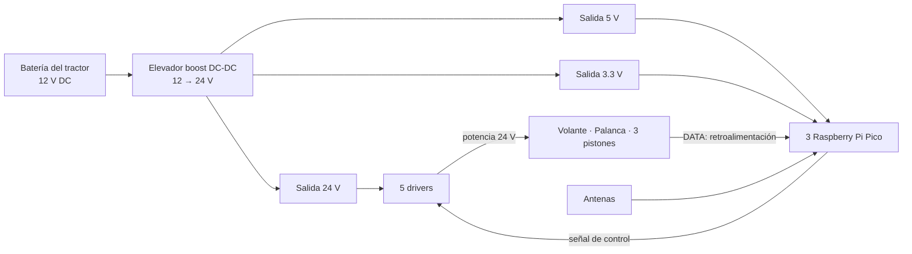

# Tablero de control

El tablero es el **gabinete que concentra la electrónica del kit** (no es el tablero de instrumentos del tractor). Se alimenta de la batería de 12 V del motor del tractor, eleva esa tensión a 24 V y entrega tres salidas reguladas (3.3 V, 5 V y 24 V) a tres Raspberry Pi Pico y a sus drivers. Las **antenas van montadas encima** de la caja.

El gabinete es una estructura de perfil de aluminio con placa de montaje perforada. Contiene la etapa de potencia, tres microcontroladores y cinco drivers de motor.

---

## Arquitectura

El tablero se divide en una **etapa de potencia** (batería → elevador → salidas reguladas) y **tres canales de control independientes**, uno por mecanismo. Cada Pico gobierna solo a sus drivers.

La separación en canales **aísla fallas**: si un canal se detiene, los otros dos conservan su control.

!!! tip "Regla fácil"
    **Un mecanismo, una Pico, su propio driver.** Si falla el volante, revisa solo su Pico y su driver. El driver más pequeño es siempre el del volante.

---

## Componentes

| Bloque | Componente | Función | Tensión / señal |
|---|---|---|---|
| Entrada | Batería del motor del tractor | Fuente primaria de energía | 12 V DC |
| Potencia | Convertidor elevador (boost) DC-DC | Eleva la tensión de la batería | 12 V → 24 V DC |
| Potencia | Salidas reguladas | Distribuyen la energía a lógica y potencia | 3.3 V, 5 V y 24 V DC |
| Control | Raspberry Pi Pico — volante | Controla el driver del volante | Lógica 3.3 V |
| Control | Raspberry Pi Pico — palanca | Controla el driver de la palanca | Lógica 3.3 V |
| Control | Raspberry Pi Pico — pistones | Controla los tres drivers de los pistones | Lógica 3.3 V |
| Potencia de salida | Driver del volante (el más pequeño) | Entrega corriente al motor del volante | 24 V |
| Potencia de salida | Driver de la palanca | Entrega corriente al mecanismo de la palanca | 24 V |
| Potencia de salida | Drivers de pistones (3, uno por pistón) | Entregan corriente a cada pistón | 24 V |
| Comunicación | Antenas (encima de la caja) | Reciben señal externa | Tipo y conexión por confirmar |

---

## Cableado y señales

Las conexiones internas forman dos redes: la de **alimentación**, que reparte las tres tensiones, y la de **control**, donde cada Pico se conecta solo con los drivers de su mecanismo.

| Tramo | Origen → destino | Tensión / señal |
|---|---|---|
| Entrada | Batería del tractor → convertidor elevador | 12 V DC |
| Elevación | Convertidor → bus de potencia | 24 V DC |
| Alimentación de potencia | Salida 24 V → los 5 drivers | 24 V DC |
| Alimentación lógica | Salidas 5 V y 3.3 V → Picos y circuitos de señal | 5 V / 3.3 V DC |
| Canal volante | Pico volante → driver del volante | Señal de control |
| Canal palanca | Pico palanca → driver de la palanca | Señal de control |
| Canal pistones | Pico pistones → 3 drivers de pistón | Señal de control (3 salidas) |
| Salida MOTOR | Cada driver → su mecanismo | Potencia 24 V |
| Entrada DATA | Cada mecanismo → su Pico | Retroalimentación de baja tensión |

---

## Fabricación

- **PCB:** sustituye el cableado suelto por pistas de cobre y hace el sistema repetible.
- **Ampacidad:** el calibre de cada cable se eligió según la corriente que lleva.
- **Paro de emergencia por hardware:** un circuito físico que corta la potencia aunque el programa esté colgado.
- **Pruebas realizadas:** continuidad, alimentación, sincronización electrónica y respuesta conjunta bajo condiciones operativas simuladas.

---

## Seguridad

El sistema mueve mandos de un vehículo pesado, así que debe poder detenerse de inmediato y sin depender del software.

- Paro de emergencia físico que corta la alimentación de los drivers.
- Protección por fusible o interruptor termomagnético en el bus de 24 V.
- Posición segura por defecto ante falla: freno aplicado y acelerador en reposo.
- Separación física de cables de potencia y de señal dentro del gabinete.

!!! warning "Por confirmar"
    Modelos del convertidor y de los drivers, corrientes nominales, fusible en la entrada de 12 V, qué carga usa la salida de 3.3 V y cuál la de 5 V, protocolo de las líneas DATA, calibre del cableado de 24 V, tipo de antenas y ubicación del paro de emergencia.

---

## Fotos

<!-- Agrega fotos en docs/recursos/ y enlázalas así:  -->
