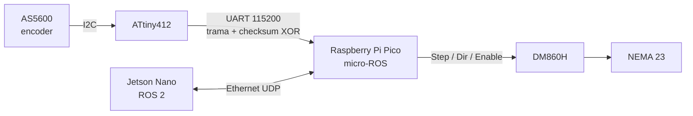

# Volante

El subsistema de dirección gira el volante con un **motor a pasos NEMA 23** acoplado por una **reducción 3:1**, y mide su posición real con un **encoder magnético absoluto AS5600**. No necesita interruptores de límite: encuentra sus topes solo al encender.

---

## Torque requerido

El torque para girar el volante se obtuvo de una **medición real con dinamómetro**: 2 kgf en el aro.

| Paso | Cálculo | Resultado |
|---|---|---|
| Fuerza | 2 kgf × 9.81 | 19.62 N |
| Radio del volante | 36.5 cm ÷ 2 | 0.1825 m |
| Torque en el volante | T = F · r = 19.62 × 0.1825 | **3.58 N·m** |
| Torque que debe dar el motor (reducción 3:1) | 3.58 ÷ 3 | 1.19 N·m |
| Margen | 9 N·m ÷ 3.58 N·m | **2.51** |

- **Reducción 3:1:** el engrane del motor tiene 20 dientes y el del volante 60. El motor da 3 vueltas por cada vuelta del volante y el torque se multiplica por 3.
- **Recorrido:** el volante gira 450° de tope a tope (una vuelta y cuarto); el motor gira 1350°.

!!! warning "El margen es teórico"
    Usa el torque máximo de la ficha técnica y no descuenta pérdidas en los engranes ni la caída de torque del motor a pasos al aumentar la velocidad. El margen existe para absorber eso.

---

## Componentes

| Componente | Modelo | Función |
|---|---|---|
| Motor | NEMA 23 (cara de 57 mm), a pasos | Gira en incrementos fijos: contar pulsos es contar ángulo |
| Driver | DM860H | Amplificador entre el micro y el motor. Señales: Step, Direction, Enable |
| Encoder | AS5600 (efecto Hall, 12 bits) | Mide la orientación de un imán pegado al eje: 0–4095 por vuelta, 0.088° por cuenta |
| Lector del encoder | ATtiny412 | Lee el AS5600 por I2C y lo envía a la Pico |
| Controlador | Raspberry Pi Pico 1 (micro-ROS) | Calcula los pasos y se comunica con ROS 2 en la Jetson Nano |
| Transmisión | Engranes 20 : 60 dientes | Reducción 3:1 |

El encoder es **absoluto**: al encender ya sabe su ángulo (uno incremental arranca en cero).

---

## Procesamiento en dos capas



- **¿Por qué dos microcontroladores?** Para que la lectura del sensor nunca espere al control ni a la red. El ATtiny solo lee y envía; la Pico calcula y se comunica. También permite poner el sensor lejos de la tarjeta principal.
- **Trama binaria con checksum XOR:** el receptor recalcula el byte de verificación y descarta el paquete si llegó dañado.
- **Multitarea cooperativa con `millis()`:** cada tarea revisa el reloj y corre solo cuando le toca; el micro nunca se bloquea.
- **Watchdog:** reinicia el micro si el programa se cuelga.
- **Lógica multivuelta (`encAbs`):** el encoder regresa a 0 después de 4095. La Pico detecta ese salto y suma o resta una vuelta para tener una posición continua.

### Tópicos ROS 2

| Tópico | Dirección | Frecuencia |
|---|---|---|
| `/tractor/steering/cmd` | ROS 2 → Pico (ángulo en radianes) | — |
| `/tractor/steering/state` | Pico → ROS 2 (estado y telemetría) | 10 Hz |

A 0.83 m/s el tractor avanza 8.3 cm entre un mensaje y el siguiente, una resolución razonable a 3 km/h.

### De radianes a pasos

```text
pasos = (ángulo ÷ 2π) × pasos_por_vuelta_del_motor × 3
```

!!! note "Por confirmar"
    Pasos por vuelta configurados en el driver: **[valor]**.

---

## Homing sin interruptores de límite

Al encender, una máquina de estados de cuatro fases encuentra los topes físicos del volante y define el centro.


1. **Periodo de gracia:** el motor avanza unos segundos sin buscar topes, para absorber el *backlash* (juego entre dientes).
2. **Detección por atasco:** cada 400 ms compara el encoder. Si el motor tiene orden de moverse y el encoder avanzó menos de 50 cuentas (≈ 4.4°), llegó al tope.
3. **Inversión y mapeo:** repite hacia el otro lado y guarda el rango total.
4. **Centrado:** mueve el volante al punto medio y lo declara 0.0 rad.

Cumple el requisito de no invasivo y se adapta a otro tractor sin reprogramar el rango.

---

## Tres capas de protección

1. **Muros virtuales:** límites por software al 50 % del recorrido medido en el homing, menos un margen para que el motor alcance a frenar.
2. **Límite duro:** la orden se satura a ±0.733 rad (≈ 42°), que es el ángulo máximo de las **ruedas** delanteras (`steer_limit` en el [modelo URDF](software.md#modelo-del-tractor-urdf)), no el giro del volante.
3. **Bandera `hardware_error`:** indicador en la telemetría que se activa si se corta el enlace UART o el bus I2C deja de responder.

!!! warning "Pendientes"
    - Qué hace la Pico si deja de recibir comandos de ROS 2 (¿tiempo límite que detenga el motor?).
    - Si el firmware corrige con la lectura del encoder cuando el motor pierde pasos, o solo lo reporta.
    - El reporte usa 3 N·m para este motor y 2.80 N·m en los pedales: unificar el valor.

---

## Piezas CAD

Archivos de SolidWorks del subsistema de dirección (piezas `.SLDPRT` y ensamble `.SLDASM`).

[:material-download: Descargar piezas del volante (.zip, 1.8 MB)](recursos/cad/Piezas_Volante.zip){ .md-button .md-button--primary }

| Archivo | Tipo | Descripción |
|---|---|---|
| `Volante.SLDASM` | Ensamble | Ensamble completo del subsistema |
| `Abrazaera.SLDPRT` | Pieza | Abrazadera de montaje al volante |
| `caja_motor_direccion.SLDPRT` | Pieza | Caja del motor de dirección |
| `driving_wheel_120mm.SLDPRT` | Pieza | Engrane del volante (120 mm) |
| `motor_gear_40mm.SLDPRT` | Pieza | Engrane del motor (40 mm) |
| `nema 27.SLDPRT` | Pieza | Modelo del motor a pasos |

!!! tip "Cómo abrirlos"
    Descomprime el `.zip` y abre `Volante.SLDASM` en SolidWorks, con todas las piezas en la misma carpeta.

---

## Código

```cpp
// Firmware de la Pico 1 (volante)
```

## Fotos

<!-- docs/recursos/ -->
